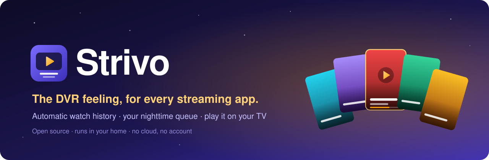
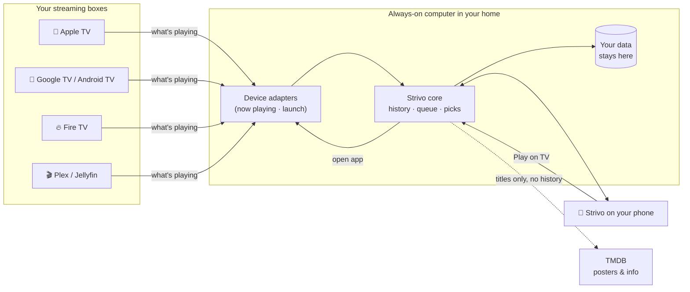

<p align="center">
  
</p>

<p align="center">
  <b>Strivo remembers everything you watch, across every streaming app, without you lifting a finger.</b><br>
  Then it tells you what's next, and plays it on your TV.
</p>

<p align="center">
  <a href="docs/ROADMAP.md"></a>
  <a href="LICENSE"></a>
  <a href="docs/COMPATIBILITY.md"></a>
  <a href="https://github.com/nickdnj/strivo/discussions"></a>
</p>

<p align="center">
  <a href="#why-strivo">Why</a> ·
  <a href="#what-it-does">What it does</a> ·
  <a href="#does-it-work-with-my-tv">Does it work with my TV?</a> ·
  <a href="#getting-started">Getting started</a> ·
  <a href="#how-it-works">How it works</a> ·
  <a href="#roadmap">Roadmap</a> ·
  <a href="#get-involved">Get involved</a>
</p>

---

## Why Strivo

Remember TiVo? One box knew every show you watched, kept your season passes, and had the next episode ready.

Streaming broke that. Your shows are scattered across six apps, each with its own half-working "Continue Watching" row. Nothing knows the whole picture: what you're in the middle of, what has new episodes tonight, what you gave up on, what you already saw on another service.

Every watch tracker that tried to fix this asked you to **log it yourself**. Nobody keeps that up.

**Strivo's one rule: it has to be fully automatic.** It listens to the streaming box you already own, so your history builds itself. You just watch TV.

> Strivo is **stream + vo**, a nod to the DVR that got it right.

## What it does

| | |
|---|---|
| 📺 **Watching** | Your nighttime queue: every series you're in the middle of, newest episodes first, across all your apps. Shows drop off when you stop watching them. |
| ▶️ **Play on TV** | Tap a show on your phone, pick a TV, and it opens in the right app. |
| ✨ **What to Watch** | Movie, series and documentary picks based on what you actually watched, filtered to the services you pay for. Tell it *why* you passed ("seen it", "too dark", "not for kids") and it learns. |
| 📰 **Daily** | Morning shows, news, late night and game shows, kept separate so they don't crowd your queue. |
| 🔖 **Saved** | Your wish list, with trailers, reviews and where it's streaming. |
| 🕰️ **History & Stats** | Everything you've watched, on which TV, and when. |
| 🎞️ **Posters view** | A full-screen, swipeable poster feed for couch browsing, or a classic list. Your choice, per screen. |
| 🔒 **Private by design** | Runs on a computer in your home. No account, no Strivo cloud, no ads, no data sold. |

> 📸 *Screenshots are coming with the first public build.*

## Does it work with my TV?

Strivo works with the **box that runs your apps**, not the brand of TV. A Samsung or LG TV works great **with a supported box plugged in**.

| Your setup | Tracking | Play on TV | Status |
|---|---|---|---|
| 🍎 **Apple TV** | ✅ Automatic (most apps) | ✅ | **Working today** |
| 🤖 **Google TV / Android TV**<br><sub>Google TV Streamer, Chromecast w/ Google TV, Nvidia Shield, Sony / TCL / Hisense / Philips Google TVs</sub> | ✅ Automatic (most apps) | ✅ | **Next up: we need testers** |
| 🔥 **Fire TV**<br><sub>Fire TV Stick / Cube, Insignia / Toshiba Fire TV Edition</sub> | ✅ Automatic (most apps) | ✅ | **Next up: we need testers** |
| 🎬 **Plex / Jellyfin / Emby** | ✅ Exact title and position, any TV | n/a | Planned |
| 🟣 **Roku** | ⚠️ Only some apps report titles | ✅ | Being measured |
| 📺 **Samsung / LG built-in apps** | ❌ App name only, never the title | Possible later | Not supported for tracking |

**Known gap:** Netflix doesn't share what you're watching with the box, even on Apple TV. A Netflix history import is on the roadmap.

👉 Full details and the community-built compatibility table: **[docs/COMPATIBILITY.md](docs/COMPATIBILITY.md)**

## Getting started

> ⚠️ **Strivo is in early development.** It runs every day in one household on Apple TV. The first public release (v0.1) is being prepared. ⭐ **Star or watch the repo** to hear when it's ready.

You'll need:

1. **A supported streaming box** (see above).
2. **An always-on computer at home.** It's very light (about 175 MB of memory). A **$60–100 Raspberry Pi** is the easiest; a Mac mini, an old PC, a NAS, or a Home Assistant box all work too.
3. **A free [TMDB](https://www.themoviedb.org/) key** for posters and recommendations.

Then, once v0.1 is out:

```bash
docker run -d --name strivo --network host --restart unless-stopped \
  -v strivo-data:/data ghcr.io/nickdnj/strivo:latest
```

Open **`http://strivo.local`** on your phone, follow the setup wizard, and add it to your home screen.

📖 **[The full install guide](docs/INSTALL.md)**: hardware specs, Raspberry Pi, NAS, Home Assistant, and remote access.

## How it works



1. **Adapters** talk to each box on your home network: what's playing now, and "open this app".
2. **The core** turns those moments into a history: which show, which episode, how long, on which TV. From that it builds your queue and picks.
3. **The app** on your phone is served from the same computer. There's nothing to install from an app store.
4. **Only show titles** go out to TMDB to fetch posters and info. Your history never leaves the house.

More detail: **[docs/ARCHITECTURE.md](docs/ARCHITECTURE.md)**

## Roadmap

| Phase | What | Status |
|---|---|---|
| **0 · Foundations** | Clean up the working household version; config and data folder; first public code | 🔜 Next |
| **1 · Easy install** | Docker image, setup wizard, auto-discovery and pairing | Planned |
| **2 · v0.1 launch** | Apple TV support, docs, screenshots, compatibility table | Planned |
| **3 · More boxes** | Google TV / Android TV / Fire TV adapter, `strivo probe`, Plex & Jellyfin | Planned |
| **4 · Everywhere** | Home Assistant add-on, Raspberry Pi image, Roku (if titles hold up), Netflix history import | Ideas |

👉 **[Full roadmap](docs/ROADMAP.md)**, and [tell us what matters to you](https://github.com/nickdnj/strivo/discussions/categories/ideas).

## Get involved

Strivo will only be great if it works in lots of living rooms, not just one. Here's how you can help, **no coding required** for most of it:

- 🧪 **Test it on your box.** Especially **Google TV, Android TV and Fire TV** owners. Run `strivo probe` and [share a compatibility report](docs/COMPATIBILITY.md#share-a-report).
- 💡 **Share ideas** in [Discussions → Ideas](https://github.com/nickdnj/strivo/discussions/categories/ideas).
- 🐛 **Report bugs** with an [issue](https://github.com/nickdnj/strivo/issues/new/choose).
- 🔌 **Write an adapter** for a device you own. Each one is a small, self-contained plug-in. See [CONTRIBUTING.md](CONTRIBUTING.md).
- 📣 **Tell a friend** who misses their DVR.

New here? Start with **[CONTRIBUTING.md](CONTRIBUTING.md)** and the [`good first issue`](https://github.com/nickdnj/strivo/labels/good%20first%20issue) label.

## FAQ

<details>
<summary><b>Is this a TiVo / DVR? Does it record shows?</b></summary>

No. Strivo doesn't record anything. It gives you the *feeling* of a DVR (one place that knows your shows) for streaming apps you already pay for.
</details>

<details>
<summary><b>Why doesn't it work with my Samsung or LG TV's built-in apps?</b></summary>

Samsung and LG only tell outside programs *which app* is open, never *what's playing in it*. Strivo's rule is fully automatic tracking, so we'd rather say "plug in a $30 streaming stick" than ask you to log shows by hand. A one-tap "was it this show?" helper may come later as an extra.
</details>

<details>
<summary><b>Why can't it run on the Apple TV / streaming stick itself?</b></summary>

Those boxes don't let apps watch what other apps are playing. Strivo has to watch from the outside, over your home network, so it needs a small always-on computer.
</details>

<details>
<summary><b>Does my data go anywhere?</b></summary>

No. Strivo runs entirely on your own computer. It looks up show and movie titles on TMDB to get posters and descriptions, but it never sends your history, your devices or anything personal.
</details>

<details>
<summary><b>Does it cost anything?</b></summary>

Strivo is free and open source (MIT). TMDB keys are free for personal use. Your only cost is the always-on computer if you don't already have one.
</details>

<details>
<summary><b>Does it skip ads or get around paywalls?</b></summary>

No. Strivo only opens the apps you already subscribe to. It never touches the video itself.
</details>

## Credits

- Apple TV support is built on the excellent **[pyatv](https://github.com/postlund/pyatv)**.
- Show and movie data from **[TMDB](https://www.themoviedb.org/)**; streaming availability from **JustWatch** via TMDB.<br>
  <sub>This product uses the TMDB API but is not endorsed or certified by TMDB.</sub>
- Strivo isn't affiliated with TiVo, Apple, Google, Amazon, Roku, Netflix or any streaming service.

## License

[MIT](LICENSE). Use it, change it, share it.

<p align="center"><sub>Made for the couch. 🛋️</sub></p>
