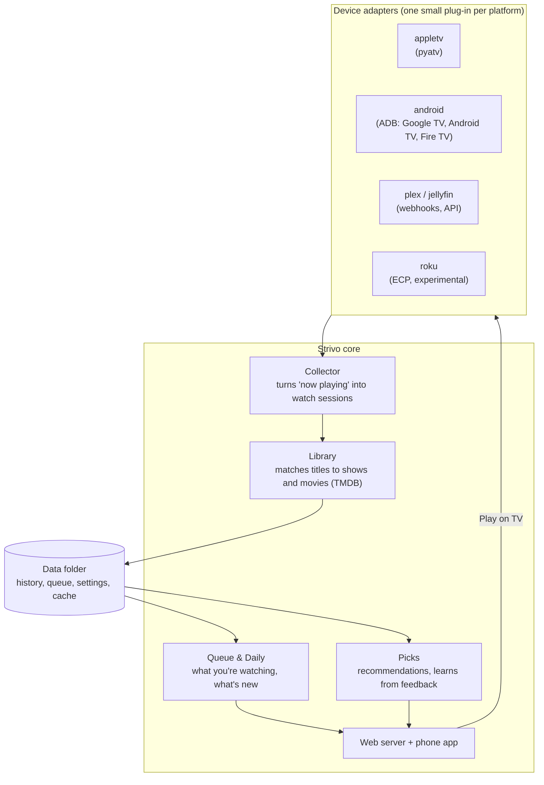

# Architecture

Strivo is deliberately small: one Python service and one web page, running on a computer in your home.



## Device adapters

Every platform is a plug-in with the same small interface:

```python
class Adapter:
    kind = "appletv"            # unique id

    async def discover(self) -> list[Device]: ...
    async def pair(self, device: Device, prompt) -> Credentials: ...
    async def now_playing(self, device: Device) -> NowPlaying | None: ...
    async def launch(self, device: Device, app: str, deep_link: str | None = None) -> None: ...
```

`NowPlaying` carries whatever the box reports: app, title, series name, season and episode, position, duration and play state. Missing fields stay empty; the core does the rest.

**Adding a platform means writing one adapter.** It doesn't touch the core, the database or the app. That's what makes it a good first contribution for someone who owns a device we don't.

## Core

- **Collector:** polls or subscribes to each device and turns a stream of "now playing" moments into **watch sessions** (what, where, start, end).
- **Library:** matches raw titles to shows and movies through TMDB, and caches posters, genres and episode info.
- **Queue:** series you're actively watching, sorted by new episodes; late-night, news and morning shows go to **Daily** instead.
- **Picks:** movies, series and documentaries similar to what you watch, filtered to your services, shaped by your "not interested because…" feedback.

## Data

Plain files in one data folder (JSON today; possibly SQLite later). Back up the folder and you have everything.

## Privacy boundary

The only outside service is **TMDB**, which receives show and movie titles to look up. It never receives your history, device names, or anything identifying.

## Tech choices

- **Python 3.11+**, standard library first; `pyatv` for Apple TV, `adb-shell` / `androidtv` for Android.
- **One HTML page** for the phone app (no build step), installable to the home screen.
- **Docker** for packaging, with host networking for device discovery.
